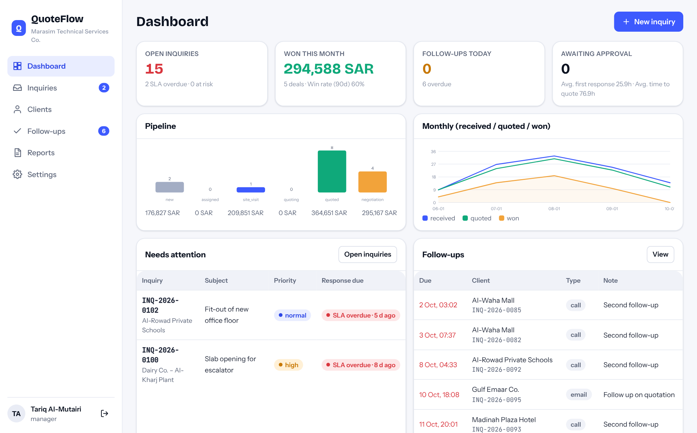
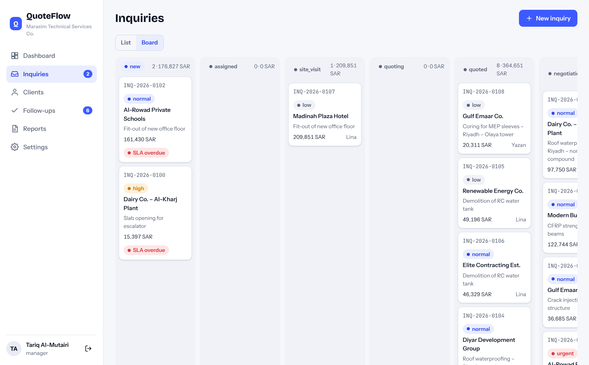
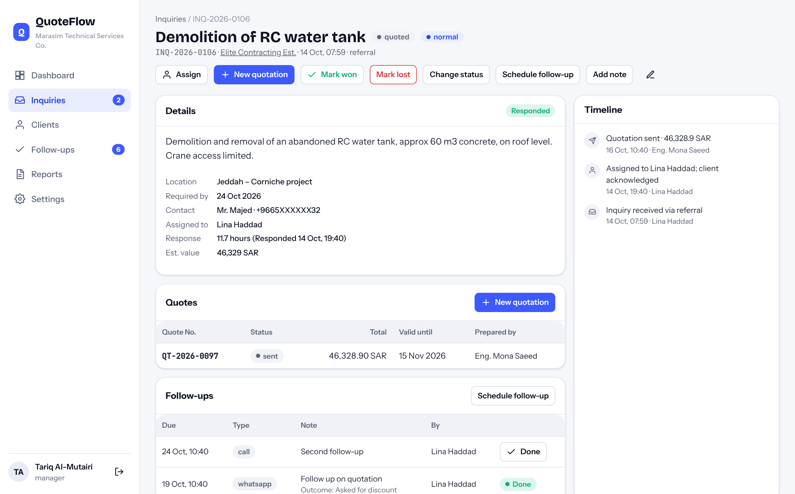
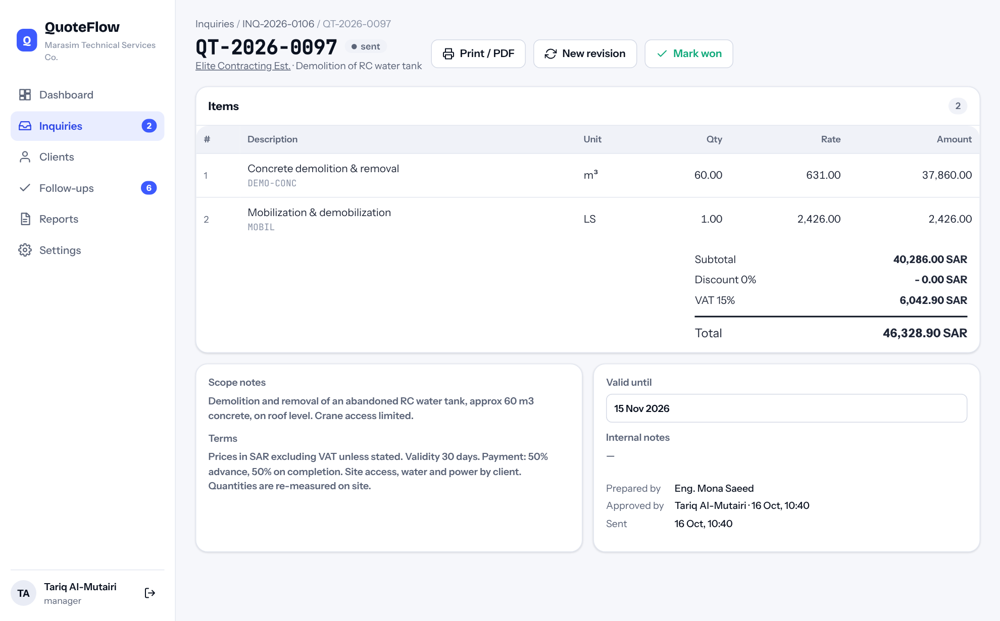
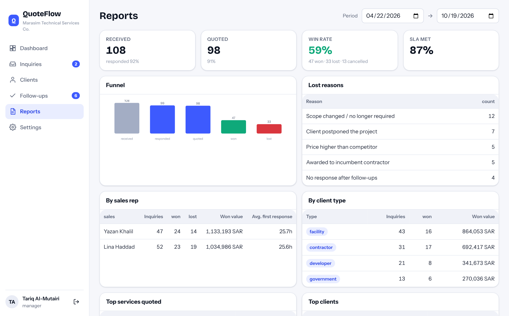
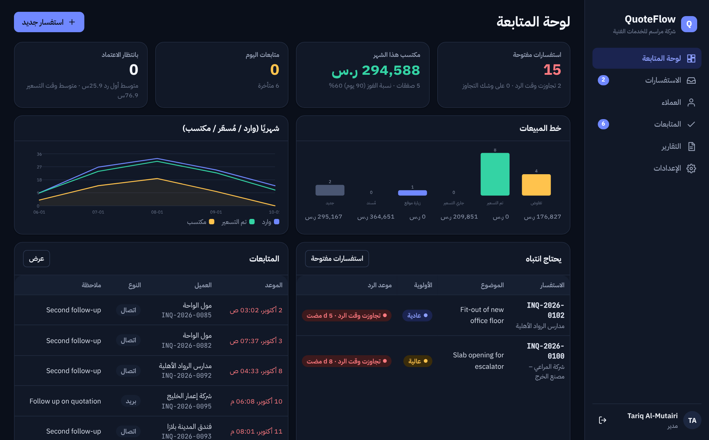

<p align="center"></p>
<h1 align="center">QuoteFlow</h1>
<p align="center"><b>Inquiry → quotation → follow-up, for service companies.</b> SLA timers, pipeline board, quotation builder with VAT, printable quotes, win/loss reports.<br>
<a href="https://hudera-ai.github.io/quoteflow/">Live demo</a> · <a href="#arabic">العربية</a> · built by <a href="https://hudera-ai.github.io">HUDERA AI</a></p>

<p align="center"></p>

A complete, working system. The same code runs in two ways:

| | How | Data |
|---|---|---|
| **Live demo** (GitHub Pages) | The web app runs SQLite inside your browser (sql.js / WebAssembly). | Sample dataset, stored in your browser only. Reset it from *Settings*. |
| **Self-hosted** | `npm start` → Node server with a REST API, sessions and an intake endpoint for website forms / WhatsApp automations, serving the same web app. | SQLite file in `data/`. |

> Sample data: the company (*Marasim Technical Services Co.*), its people, clients and figures are fictional and exist only to demonstrate the product.

## What it does

- **Every inquiry in one place** — from WhatsApp, e-mail, phone, site visits, the website or referrals — with client, subject, details, location, priority and the person responsible.
- **SLA timers.** Each priority has a first-response target (urgent 4h · high 24h · normal 48h · low 72h). The dashboard shows what is overdue or at risk; the clock stops when someone marks the inquiry responded or completes a follow-up.
- **Pipeline board** (new → assigned → site visit → quoting → quoted → negotiation) with value per stage, plus a filterable list.
- **Quotation builder with assisted drafting.** *New quotation* reads the inquiry text (Arabic or English) and proposes line items from the company's service catalogue with quantities — "كور 30 نقطة قطر 150 وقص جدار 18 م.ط" becomes two priced lines plus mobilization. Edit lines, apply a discount, VAT is computed; numbering `QT-YYYY-NNNN` with revisions.
- **Approval workflow:** estimator/sales drafts → submits → manager approves & sends (or returns with a comment) → sent quotes are locked; revisions supersede the previous one.
- **Printable quotation (A4)** with company header, client block, items, totals, terms, bank details and signature blocks.
- **Follow-ups** with due dates and outcomes; overdue and today's lists; one-tap WhatsApp link to the client.
- **Reports:** funnel, win rate, SLA compliance, performance by sales rep, client type, top services, lost reasons, top clients — for any period.
- **Clients** with history and won value; **services catalogue** with base rates; audit log; roles (admin, manager, sales, estimator).
- **Arabic / English UI**, RTL, light/dark, responsive.

## Run it locally

```bash
git clone https://github.com/hudera-ai/quoteflow.git
cd quoteflow
npm install
npm start            # → http://localhost:8788
```

Demo users (password `demo1234`): `nour@marasim.example` (admin) · `tariq@marasim.example` (manager) · `lina@marasim.example`, `yazan@marasim.example` (sales) · `hani@marasim.example`, `mona@marasim.example` (estimators).

`npm run seed` resets the sample data · `npm test` runs the test suite (estimator, totals, SLA, workflow).

### Intake endpoint
`POST /intake` with `{name, company, phone, email, subject, message, channel}` creates (or matches) the client and opens an inquiry — wire it to a website form, Make/Zapier, or a WhatsApp automation. Protect it with `INTAKE_TOKEN` (header `x-intake-token`).

## Architecture

```
quoteflow/
├── index.html, src/, assets/     web app (vanilla ES modules, no build step)
│   └── src/api.js                one client interface, two transports: HTTP or in-browser SQLite
├── shared/                       code used by BOTH the server and the browser demo
│   ├── service.js                every operation (auth, clients, inquiries, quotations, follow-ups, reports)
│   ├── estimator.js              inquiry text → draft line items; totals; SLA helpers
│   ├── seed.js                   deterministic sample dataset
│   └── auth.js, dbx.js           PBKDF2 passwords (Web Crypto), SQL helper
├── server/src/                   Express API, sessions, intake endpoint
├── db/schema.sql                 SQLite schema
├── tests/                        node:test suite
└── docs/                         screenshots, API reference
```

REST reference: [docs/API.md](docs/API.md).

## Screenshots

| Pipeline board | Inquiry |
|---|---|
|  |  |

| Quotation | Reports | Arabic, dark |
|---|---|---|
|  |  |  |

A sample printed quotation: [docs/quotation-sample.pdf](docs/quotation-sample.pdf).

## Production notes

This repository is a product demo that is deliberately dependency-light. For a client deployment HUDERA AI typically adds PostgreSQL, persistent sessions, e-mail/WhatsApp sending of quotations, e-signature, ZATCA-compliant invoicing after award, and the client's own quotation template and approval limits.

---

<a id="arabic"></a>
## QuoteFlow بالعربية

**نظام متابعة الاستفسارات وعروض الأسعار** لشركات الخدمات والمقاولات: من وصول الاستفسار إلى عرض السعر إلى المتابعة حتى الفوز أو الخسارة.

- **كل الاستفسارات في مكان واحد** (واتساب، بريد، هاتف، زيارة، الموقع الإلكتروني) مع العميل والأولوية والمسؤول.
- **مؤقت الرد (SLA):** لكل أولوية وقت رد مستهدف، واللوحة تعرض المتأخر والمعرض للتأخر.
- **لوحة خط المبيعات** (جديد ← مُسند ← زيارة ← تسعير ← تم التسعير ← تفاوض) بقيمة كل مرحلة.
- **مُنشئ عروض الأسعار بمساعدة ذكية:** يقرأ نص الاستفسار بالعربي أو الإنجليزي ويقترح البنود من قائمة الخدمات بالكميات، ثم تعدّل وتضيف الخصم وتُحسب الضريبة، مع ترقيم ومراجعات.
- **دورة اعتماد:** إعداد ← إرسال للاعتماد ← المدير يعتمد ويرسل أو يعيد بتعليق ← العرض يُقفل بعد الإرسال.
- **طباعة عرض السعر A4** بترويسة الشركة وبيانات العميل والبنود والشروط والتوقيعات.
- **متابعات** بمواعيد ونتائج، ورابط واتساب مباشر للعميل.
- **تقارير:** القمع، نسبة الفوز، الالتزام بوقت الرد، الأداء حسب المندوب ونوع العميل والخدمة، أسباب الخسارة.
- **عربي/إنجليزي** مع RTL، فاتح وداكن، ويعمل على الموبايل.

> البيانات تجريبية: الشركة (مراسم للخدمات الفنية) والأشخاص والعملاء والأرقام كلها افتراضية لغرض العرض فقط.

**التشغيل:** `npm install` ثم `npm start` على `http://localhost:8788` — كلمة مرور المستخدمين التجريبيين `demo1234`.

---
© 2026 HUDERA AI · AI automation & SaaS products for businesses in Saudi Arabia and the Gulf · [hudera-ai.github.io](https://hudera-ai.github.io)
