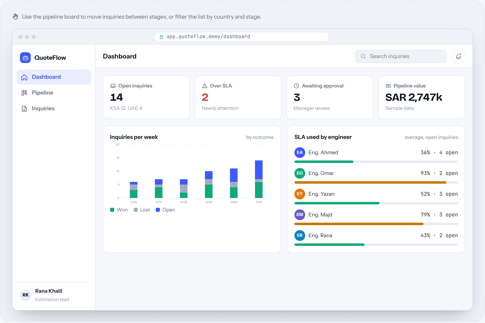
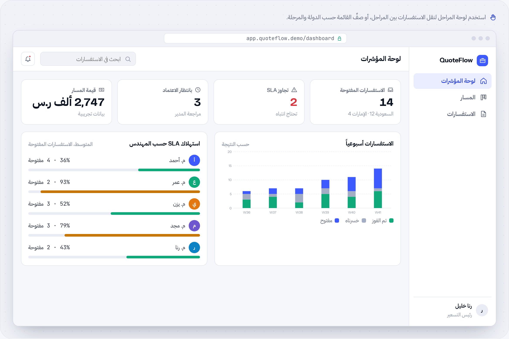

# QuoteFlow

**Inquiry & quotation tracking SaaS** · SaaS & web apps · by [HUDERA AI](https://www.linkedin.com/company/hudera)

A multi-user web app that tracks every inquiry from arrival to submitted quotation, with SLA timers, a pipeline board, roles and reports.

**[▶ Try the live demo](https://hudera-ai.github.io/quoteflow/)** · runs in your browser on sample data · Arabic & English

## The problem
Inquiries arrive from several sales reps and countries. Managers can't see who holds each one, how long it has waited, or why it is late.

## What it does
QuoteFlow gives each inquiry a number and a path through clear stages. The SLA clock starts when an engineer accepts it and counts working hours. Roles, permissions, an activity log with undo, and bilingual reports are built in.

## Business value
Managers see the whole pipeline and every delay in one place. Engineers know what is theirs and what is due next.

## Features
| Feature | Details |
| --- | --- |
| Pipeline board | Move inquiries between stages |
| SLA timers | Working hours, from acceptance |
| Roles & permissions | Per role and per person |
| Multi-country | KSA and UAE with own currency and VAT |
| Activity log | With undo and a 30-day bin |
| Reports | PDF and Excel, Arabic and English |

## How the workflow runs
**Intake**: Inquiry logged → **Assign**: Engineer accepts → **Study**: Scope & pricing → **Approve**: Manager review → **Submit**: Quotation sent

## Typical stack
React · Firebase (Auth, Firestore) · Role-based security rules · PDF & Excel export

## Run it locally
Open `index.html` in any modern browser. No build step, no server, no data leaves your machine.

---

## QuoteFlow بالعربي

**منصة SaaS لمتابعة الاستفسارات وعروض الأسعار**

تطبيق ويب متعدد المستخدمين يتابع كل استفسار من وصوله حتى تقديم عرض السعر، مع مؤقتات SLA ولوحة مراحل وصلاحيات وتقارير.

### المشكلة
الاستفسارات تصل من عدة مندوبين ودول، والمدير لا يعرف من يمسك كل استفسار ولا كم انتظر ولا سبب تأخره.

### ما الذي يفعله
يعطي QuoteFlow كل استفسار رقماً ومساراً بمراحل واضحة. عدّاد SLA يبدأ عند قبول المهندس ويحسب ساعات العمل فقط. الأدوار والصلاحيات وسجل النشاط مع التراجع والتقارير بلغتين مدمجة فيه.

### القيمة للأعمال
المدير يرى كل المراحل وكل تأخير في مكان واحد، والمهندس يعرف ما المطلوب منه وما المستحق بعده.

### المزايا
| الميزة | التفاصيل |
| --- | --- |
| لوحة المراحل | انقل الاستفسارات بين المراحل |
| مؤقتات SLA | ساعات عمل، من لحظة القبول |
| الأدوار والصلاحيات | لكل دور ولكل شخص |
| متعدد الدول | السعودية والإمارات بعملة وضريبة كل دولة |
| سجل النشاط | With undo and a 30-day bin |
| التقارير | PDF وExcel، عربي وإنجليزي |

### كيف يسير العمل
**الاستلام**: تسجيل الاستفسار ← **الإسناد**: المهندس يقبل ← **الدراسة**: النطاق والتسعير ← **اعتماد**: مراجعة المدير ← **Submit**: إرسال عرض السعر

---

## About HUDERA AI
HUDERA AI builds WhatsApp AI assistants, business dashboards, workflow automations and custom SaaS products for companies in Saudi Arabia and the Gulf.

- LinkedIn: [linkedin.com/company/hudera](https://www.linkedin.com/company/hudera)
- Email: hudera.ai@gmail.com
- WhatsApp: [+20 155 515 9139](https://wa.me/201555159139)

> This repository is a product demo. Company names, people and figures inside it are fictional sample data.

© 2026 HUDERA AI. All rights reserved.
